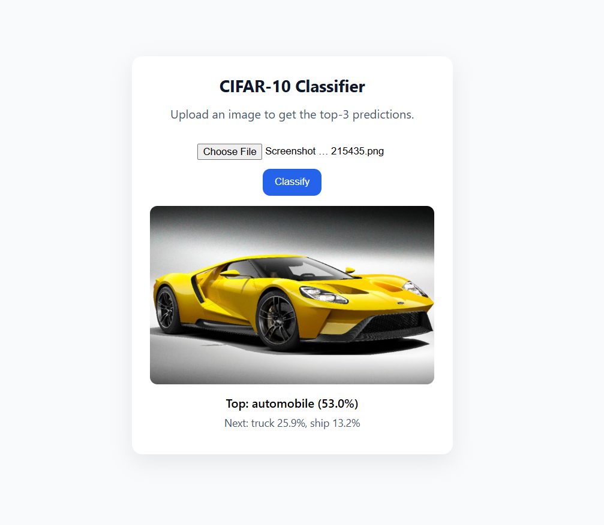

Image Classifier (CIFAR-10, TensorFlow + Flask)

A deep learning image classification project trained on the CIFAR-10 dataset using TensorFlow/Keras, achieving ~92% accuracy. The trained model is deployed via a Flask REST API with a simple web interface for uploading and classifying images.

Features

CNN / Transfer learning (MobileNetV2 / ResNet) trained on CIFAR-10

Training pipeline with early stopping & checkpointing

Flask API (/predict) for real-time inference

Simple upload page to test the model in the browser

Docker support for easy deployment

Installation

Clone the repo and install dependencies:

git clone https://github.com/SawairaBibi99/Image-Classifier.git
cd Image-Classifier

# create venv (Python 3.10/3.11 recommended)
python -m venv .venv
.venv\Scripts\activate   # Windows
# or source .venv/bin/activate   # Linux/Mac

pip install -r requirements.txt

Training the Model
python train.py

The trained model will be saved to:

saved_model/classifier.keras

Running the API
python app.py

API: http://localhost:8000/predict

Health check: http://localhost:8000/health

Web UI: http://localhost:8000/

Example Usage

cURL request:

curl -X POST http://localhost:8000/predict -F "file=@sample.png"

JSON response:

{
  "predictions": [
    {"class": "cat", "prob": 0.82},
    {"class": "dog", "prob": 0.15},
    {"class": "ship", "prob": 0.02}
  ]
}

Demo

Here’s what the web interface looks like:

📂 Project Structure
Image-Classifier/
│── app.py              # Flask API
│── train.py            # Model training script
│── infer_utils.py      # Preprocessing & inference helpers
│── requirements.txt
│── Dockerfile
│── templates/          # HTML frontend
│── saved_model/        # Trained model (ignored in git)
